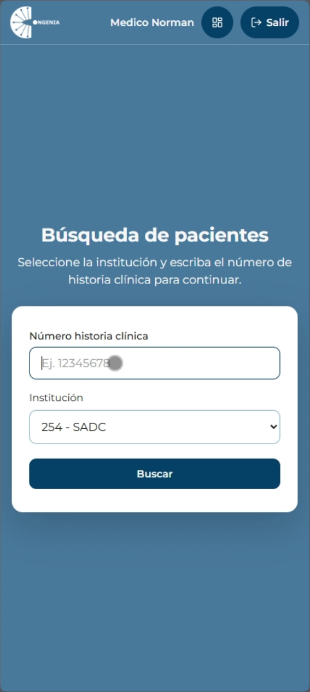
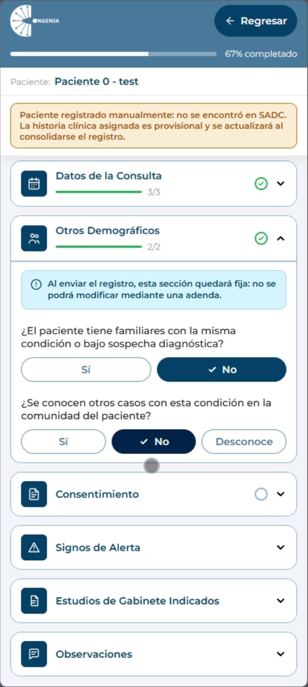
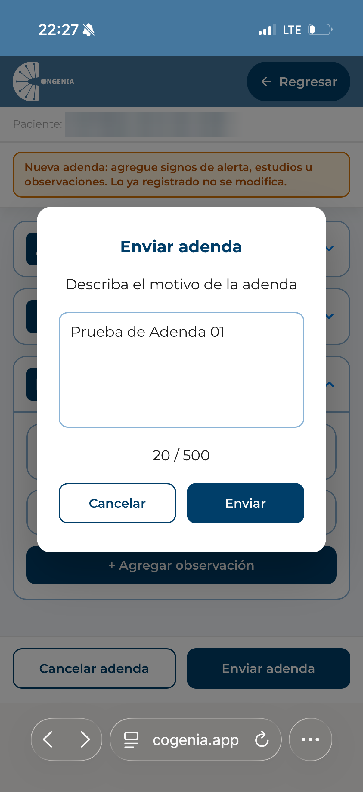
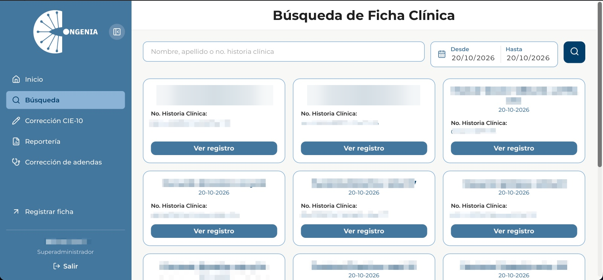

# CONGENIA: Módulo de Base de Datos y Seguridad Informática

Sistema de apoyo a la decisión clínica para la sospecha de condiciones genéticas pediátricas mediante inteligencia artificial y análisis de datos clínicos en el Hospital Regional de Cobán.

Trabajo de graduación, modalidad Trabajo Profesional, Universidad del Valle de Guatemala, 2026.

## Descripción

En el Hospital Regional de Cobán, la sospecha de una condición genética en pediatría depende de que el médico registre de forma completa y oportuna los signos de alerta, los antecedentes y los estudios del paciente. Antes de CONGENIA, esa información quedaba dispersa en papel y en el sistema hospitalario (SADC), sin estructura ni trazabilidad.

CONGENIA extiende el sistema hospitalario con una **ficha clínica genética** digital. Así funciona:

- **Integración con SADC.** El médico busca al paciente por número de historia clínica. Si el paciente existe en SADC, la ficha se pre-puebla con sus datos. Si no existe, se crea un **registro provisional**, que se consolida cuando el paciente aparece en SADC.
- **Ficha versionada.** La ficha registra demografía, consentimiento informado con firma, signos de alerta con fotografía, estudios de gabinete y observaciones. Una ficha enviada no se edita: cada corrección entra como **adenda**, que un coordinador aprueba o rechaza.
- **Codificación CIE-10 asistida por IA.** Un proceso por lotes sugiere códigos CIE-10 para los diagnósticos en texto libre, y un revisor humano los valida.
- **Reportería.** Un tablero muestra indicadores e incluye un agente de consulta en lenguaje natural de solo lectura.

Este trabajo corresponde al **módulo de Base de Datos y Seguridad Informática**, que comprende:

- El modelo relacional en PostgreSQL, con versionado de la ficha e integridad referencial.
- La API centralizada como frontera de control.
- La autenticación y autorización con Keycloak (OAuth 2.0/OIDC), con control de acceso por rol aislado por institución.
- El cifrado de datos identificables.
- La bitácora de auditoría inmutable, encadenada con hashes.

### Módulos del repositorio

| Carpeta | Contenido | Responsable principal |
|---|---|---|
| `src/` (raíz) | Orquestación local con Docker Compose y Keycloak con el realm `congenia` | Equipo |
| `src/CONGENIA-M1-SERVER` | API Express, esquema y migraciones (`db/init`), auditoría, RBAC | Josué Marroquin |
| `src/CONGENIA-DB` | Documentación generada del esquema de base de datos | Josué Marroquin |
| `src/CONGENIA-M1` | Frontend web (React + Vite + TypeScript) | Nahomy Castro |
| `src/CONGENIA-CIE10` | Lote de codificación CIE-10 asistido por IA | Xavier López |
| `src/CONGENIA-M1-PDF-WORKER` | Generación asíncrona del PDF de consentimiento (RabbitMQ → PDF → S3) | Xavier López |
| `src/CONGENIA-INFRA` | Infraestructura como código en AWS (Terraform) | Gerson Ramírez |

## Tecnologías utilizadas

- **Frontend:** React, Vite, TypeScript.
- **Backend:** Node.js 22, Express.
- **Datos:**
  - PostgreSQL 16: esquema relacional, versionado de la ficha y bitácora encadenada.
  - Redis 7: sesiones temporales de integración.
- **Identidad:** Keycloak 26 con OAuth 2.0 y OpenID Connect.
- **Mensajería y archivos:** RabbitMQ 3.13, y SeaweedFS en local o Amazon S3 en la nube.
- **Inteligencia artificial:** API de OpenAI para la sugerencia de códigos CIE-10 y el agente de reportería.
- **Infraestructura:**
  - Docker y Docker Compose para el entorno local.
  - Terraform en AWS: ECS Fargate, RDS, ElastiCache, S3, Secrets Manager, ALB, WAF y Route 53.
  - GitHub Actions con OIDC.

## Requisitos previos

| Software | Versión | Uso |
|---|---|---|
| Git | 2.40 o superior | Clonar el repositorio |
| Docker | 24.0 o superior | Ejecutar el sistema completo |
| Docker Compose | v2.20 o superior | Orquestación local |
| Node.js | 22 o superior (opcional) | Desarrollar o probar un módulo fuera de Docker |
| Terraform y AWS CLI | Terraform 1.10 o superior (opcional) | Desplegar la infraestructura en AWS |

PostgreSQL, Redis, RabbitMQ, Keycloak y SeaweedFS se levantan como contenedores, así que no hace falta instalarlos en el equipo.

## Instalación

1. Clonar el repositorio y entrar a la carpeta del código:

   ```bash
   git clone https://github.com/GraduacionesUVG/2026-22397-marroquin-jimenez-josue-roberto.git
   cd 2026-22397-marroquin-jimenez-josue-roberto/src
   ```

2. Copiar la plantilla de variables de entorno:

   ```bash
   cp .env.example .env
   ```

3. Editar `.env` y asignar valores a las variables requeridas:
   - `POSTGRES_PASSWORD` y `POSTGRES_APP_PASSWORD`
   - `APP_ENCRYPTION_KEY`: 64 caracteres hexadecimales. Se genera con `openssl rand -hex 32`.
   - `REDIS_PASSWORD` y `RABBITMQ_DEFAULT_PASS`
   - `KEYCLOAK_ADMIN_PASSWORD`, `KEYCLOAK_SADC_CLIENT_SECRET` y `KEYCLOAK_MEDICO_INITIAL_PASSWORD`
   - `S3_SECRET_ACCESS_KEY`

   La tabla completa de variables está en [`src/README.md`](src/README.md#configuración).

## Ejecución

Desde la carpeta `src/`:

```bash
docker compose up -d   # construye y levanta todos los servicios
docker compose ps      # verifica que estén en estado healthy
docker compose logs -f # sigue los registros
```

Al iniciar, PostgreSQL aplica el esquema y las migraciones de `CONGENIA-M1-SERVER/db/init`.

| Servicio | URL |
|---|---|
| Frontend | http://localhost:8080 |
| API | http://localhost:3000 |
| Documentación de la API | http://localhost:3000/docs |
| Keycloak | http://localhost:8082 |
| Consola de RabbitMQ | http://localhost:15672 |

Para entrar al frontend se usa el usuario `medico.inicial`, con la contraseña definida en `KEYCLOAK_MEDICO_INITIAL_PASSWORD`.

Componentes opcionales:

- **Lote CIE-10:** se ejecuta con `docker compose --profile jobs run --rm cie10_batch`. Requiere `OPENAI_API_KEY` y los catálogos CIE-10 en CSV, que no forman parte del repositorio.
- **Despliegue en AWS:** está documentado en [`src/CONGENIA-INFRA/README.md`](src/CONGENIA-INFRA/README.md) y [`src/CONGENIA-INFRA/docs/DEPLOY.md`](src/CONGENIA-INFRA/docs/DEPLOY.md). En la documentación, `<AWS_ACCOUNT_ID>` reemplaza el identificador de la cuenta de producción.

Cada módulo trae su propio `README.md`, `package.json` y `.env.example` para trabajarlo de forma independiente.

## Capturas

Las capturas están en [`/capturas`](capturas/), en el orden de uso del sistema. En todas, los datos de pacientes son de prueba o aparecen difuminados.

| # | Pantalla |
|---|---|
| [01](capturas/captura-01.png) | Búsqueda del paciente en SADC por número de historia clínica |
| [02](capturas/captura-02.png) | Registro manual de un paciente que no está en SADC (registro provisional) |
| [03](capturas/captura-03.png) | Ficha clínica de un paciente con registro provisional |
| [04](capturas/captura-04.png) | Ficha clínica genética |
| [05](capturas/captura-05.png) | Ficha guardada |
| [06](capturas/captura-06.png) | Estudios de gabinete indicados |
| [07](capturas/captura-07.png) | Búsqueda de fichas clínicas (panel del coordinador) |
| [08](capturas/captura-08.png) | Aviso al iniciar una adenda |
| [09](capturas/captura-09.png) | Adenda: reemplazo de un signo de alerta |
| [10](capturas/captura-10.png) | Adenda: reemplazo de un estudio de gabinete |
| [11](capturas/captura-11.png) | Motivo de la adenda |
| [12](capturas/captura-12.png) | Adenda enviada a revisión |
| [13](capturas/captura-13.png) | Lote CIE-10 con sugerencias de la IA para revisión humana |
| [14](capturas/captura-14.png) | Reportería e indicadores |

<p>
  
  
  
  
</p>

## Demo

El video está en [`demo/demo.mp4`](demo/demo.mp4). Dura 10 minutos, tiene narración y recorre de principio a fin:

1. La búsqueda en SADC y el registro provisional.
2. El llenado de la ficha, con consentimiento y firma.
3. Las adendas y su revisión.
4. El lote CIE-10.
5. La reportería.

## Documentación

- Informe final: [`docs/informe_final.pdf`](docs/informe_final.pdf)

## Consentimiento firmado

- Consentimiento de uso de fotografía y video: [`docs/consentimiento_firmado.pdf`](docs/consentimiento_firmado.pdf)

## Autores

| Nombre | Carné | Rol |
|---|---|---|
| Josué Roberto Marroquin Jiménez | 22397 | Base de Datos y Seguridad Informática (autor de esta entrega) |

El proyecto CONGENIA se desarrolló en equipo:

- Nahomy Castro: frontend.
- Xavier López: componentes analíticos, CIE-10 e IA.
- Gerson Ramírez: infraestructura.

Asesor: Ing. Gabriel Brolo Tobar.

## Licencia

© 2026 Equipo CONGENIA. Todos los derechos reservados.

El código se publica solo para la evaluación del trabajo de graduación en la Universidad del Valle de Guatemala. No se concede permiso para copiarlo, modificarlo ni distribuirlo sin autorización escrita de los autores. Los términos completos están en [`LICENSE`](LICENSE).
